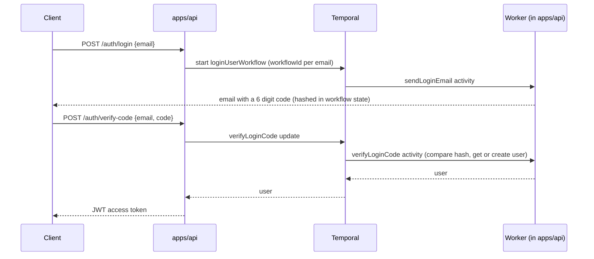

# ProjectX API

<p align="center">
  
  
  
  
</p>

> **ProjectX API** is a domain-agnostic template for building a backend with **NestJS** and **Temporal**. It ships one app, `apps/api`, with passwordless email login driven by a Temporal workflow, JWT sessions, users with role-based access control, health checks, Swagger, and a Temporal worker and client running in the same process. Bring your own domain: generators add modules and workflows that are wired, typed and tested from the first commit.

It is the API-only sibling of [ProjectX](https://github.com/proyecto26/projectx), the full-stack e-commerce template. Both share the same conventions and the same Temporal wrapper.

## Features

- One NestJS 12 app (`apps/api`) in a Turborepo + pnpm monorepo
- Email OTP login as a Temporal workflow (signals, queries and updates), then a JWT
- Users, roles (`admin`, `user`) and a `RolesGuard` that reads roles from the database on every request
- Temporal worker and client in-process through [`@proyecto26/temporal-workflows`](https://www.npmjs.com/package/@proyecto26/temporal-workflows)
- PostgreSQL (PostGIS) with Prisma 7, repository services and a seed
- SendGrid + MJML email templates, with a log transport for local development
- `/health` that checks the database and Temporal (client, namespace and worker)
- Swagger UI, Pino logging, Helmet, CORS, validation pipes
- Generators: `pnpm gen:module` and `pnpm gen:workflow` (workflow + activity + test), checked in CI by `pnpm test:generators`
- Docker Compose for everything: database, Temporal (with Elasticsearch and the UI) and the API
- AI-ready: agent skills (NestJS, Prisma, Temporal, Turborepo) and a visual Temporal workflow playground

## Why Temporal?

Most backends grow processes that span time and systems: send a code and wait for the user, call a provider and retry, run a job every night, compensate when step three fails. Written as request handlers and cron jobs they turn into state machines spread across tables and queues.

**Temporal** runs those processes as code (**workflows**) with durable execution: state survives crashes and deploys, side effects (**activities**) are retried with backoff, and a workflow can wait for hours or months for an external event (**signals**, **updates**) while you inspect it at any time (**queries**). The login in this template is the smallest real example: the workflow emails a one-time code, waits for the user to submit it through an update, and finishes with the verified user.

## Getting Started

### Prerequisites

- [Docker Compose](https://docs.docker.com/compose/install)
- [Node.js 24](https://nodejs.org) (24.9 or later; the Jest suites load the ESM-only NestJS 12 packages through `require(esm)`)
- [pnpm](https://pnpm.io) (the version is pinned in `package.json`; `corepack enable` picks it up)

### Quick start

```bash
git clone https://github.com/proyecto26/projectx-api.git
cd projectx-api
cp .env.example .env

# Database, Temporal, Elasticsearch, Temporal UI, builder (install, build, migrate, seed) and the api
docker compose up -d
```

The API listens on `http://localhost:8081` (`API_PORT`), Swagger on `http://localhost:8081/swagger` and the Temporal UI on `http://localhost:8080`.

To run the API on the host instead (hot reload), start only the infrastructure and run it with pnpm:

```bash
docker compose up -d db temporal temporal-create-namespace temporal-ui
pnpm install
pnpm prisma:generate && pnpm build   # Prisma client and the shared packages
pnpm prisma:migrate && pnpm prisma:seed
pnpm dev:api                         # builds its workspace dependencies first
```

### Try the login

With `SENDGRID_API_KEY` empty and `NODE_ENV=development`, emails are printed to the API logs instead of being sent.

```bash
# 1. Request a code (starts the login workflow)
curl -X POST http://localhost:8081/auth/login \
  -H 'Content-Type: application/json' -d '{"email":"admin@example.com"}'

# 2. Read the 6 digit code from the logs
docker compose logs api | grep -i code

# 3. Verify it and get a JWT
curl -X POST http://localhost:8081/auth/verify-code \
  -H 'Content-Type: application/json' -d '{"email":"admin@example.com","code":123456}'

# 4. Call a protected route
curl http://localhost:8081/users/me -H "Authorization: Bearer <accessToken>"
```

`admin@example.com` is in `ADMIN_EMAILS`, so the seed made it an admin and `GET /users` (admin only) answers too. Any other email gets the `user` role and a `403` there.

## How it works

### Authentication flow



The workflow lives in `apps/api/src/workflows/login.workflow.ts`; its queries and updates are defined in `@projectx/core/workflows`. The code expires after `LOGIN_WORKFLOW_TIMEOUT`.

### Authorization (RBAC)

- `JwtAuthGuard` (from `@projectx/core`) validates the token and sets `request.user`.
- `@Roles(RoleName.Admin)` + `RolesGuard` restrict a route to roles. The guard loads the user's roles with one indexed query per request instead of trusting the token, so revoking a role takes effect immediately. The JWT strategy also checks that the account is still active, so suspending or deleting it rejects its tokens on the next request.
- New users get the `user` role. `pnpm prisma:seed` creates the `admin` and `user` roles and promotes every email in `ADMIN_EMAILS` to `admin`.
- `Permission` and `RolePermission` exist in the schema for fine-grained checks later; the guard checks role names only.

```ts
@Roles(RoleName.Admin)
@UseGuards(JwtAuthGuard, RolesGuard)
@Controller("users")
export class UsersController {}
```

### Temporal in the app

`WorkflowsModule` from `@proyecto26/temporal-workflows` starts a worker (task queue `TEMPORAL_TASK_QUEUE`, default `api`) and a client inside the API process. The worker bundles `apps/api/src/workflows` and registers activities from one object, `ActivitiesService` (`apps/api/src/activities/activities.service.ts`): every method on its prototype becomes an activity. Feature activities are injectable classes in their modules (`<feature>.activities.ts`) and `ActivitiesService` delegates to them. See [docs/backend/TEMPORAL.md](./docs/backend/TEMPORAL.md).

`@proyecto26/temporal-workflows` is consumed from npm. It is developed and published from the [ProjectX repository](https://github.com/proyecto26/projectx) (`packages/workflows`); report issues and send changes there.

## Project structure

```
projectx-api/
├── apps/
│   └── api/                 # NestJS app: auth, users, health, swagger, Temporal worker + client
│       └── src/
│           ├── activities/  # ActivitiesModule + ActivitiesService (the worker's activity registry)
│           ├── app/         # AppModule and feature modules (auth, user, ...)
│           ├── config/      # app, swagger, temporal config + env validation
│           ├── temporal/    # Temporal health indicator
│           └── workflows/   # Temporal workflows (bundled for the worker)
├── packages/
│   ├── cli/                 # `pnpm cli`: init, info, generate
│   ├── core/                # Shared NestJS: auth guards, RBAC, config, logger, health, swagger, workflow utils
│   ├── db/                  # Prisma schema, migrations, seed and repository services
│   ├── email/               # SendGrid + MJML templates, log transport
│   └── models/              # DTOs, enums, validators shared by the packages
├── turbo/generators/        # gen:module and gen:workflow templates + their CI check
├── deployment/              # Temporal setup scripts and dynamic config
├── docs/                    # Architecture and backend guides
└── docker-compose.yml
```

## Common commands

```bash
pnpm dev:api              # Run the API with hot reload
pnpm build                # Build everything (pnpm build:api for the app and its packages)
pnpm lint                 # Biome (pnpm lint:fix to fix)
pnpm typecheck
pnpm test                 # Unit tests
pnpm test:e2e             # E2E tests (needs the database)
pnpm prisma:generate      # Generate the Prisma client
pnpm prisma:migrate:dev   # Create/apply migrations in development
pnpm prisma:migrate       # Apply migrations
pnpm prisma:seed          # Roles + admins from ADMIN_EMAILS
```

## Adding a module

```bash
pnpm gen:module           # or: pnpm cli generate module
```

Creates `apps/api/src/<name>/` with a module, a JWT-protected controller, a service and a controller spec, and adds the module to `AppModule`. Add a repository in `packages/db` for persistence, DTOs in `packages/models`, and `@Roles(...)` with `RolesGuard` where a route needs a role.

## Adding a workflow and its activity

```bash
pnpm gen:workflow         # or: pnpm cli generate workflow
```

Prompts for the workflow name (camelCase), the feature that owns the activity and the activity name, then:

1. creates `apps/api/src/workflows/<name>.workflow.ts` and exports it from `workflows/index.ts`;
2. adds the activity to `apps/api/src/<feature>/<feature>.activities.ts`, an injectable class provided and exported by its feature module (both created if the feature is new);
3. imports the feature module in `ActivitiesModule`;
4. injects the class in `ActivitiesService` and adds a method that delegates to it;
5. creates `<name>.workflow.spec.ts`, which boots the real `ActivitiesModule`, registers activities the way the worker does and runs the workflow with `TestWorkflowEnvironment`.

Start the workflow from a service with `ClientService` (see [docs/backend/TEMPORAL.md](./docs/backend/TEMPORAL.md)). `pnpm test:generators` runs both generators in a temporary copy of the repo, builds the app and runs the generated tests; CI runs it on every push.

## ProjectX CLI

```bash
pnpm cli                      # Interactive mode
pnpm cli generate module      # Same as gen:module (flags: -n, -d, -y)
pnpm cli generate workflow    # Same as gen:workflow (flags: -n, -f, -a, -d, -y)
pnpm cli info                 # Modules, workflows, activities and packages
pnpm cli init                 # Rename @projectx/* to your scope and the Docker project
```

## Environment variables

Copy `.env.example` to `.env`. The API validates its configuration at startup.

| Variable | Purpose |
|----------|---------|
| `NODE_ENV` | `development`, `production` or `test` |
| `API_PORT` | API port (default `8081`); `API_DEBUG_PORT` is the inspector port in Docker (`9229`) |
| `DATABASE_URL` | PostgreSQL connection (built from `POSTGRES_*`) |
| `TEMPORAL_HOST` | Temporal frontend address (`localhost:7233` on the host, `temporal:7233` in Compose) |
| `TEMPORAL_NAMESPACE` | Namespace (default `default`), created by `temporal-create-namespace` with `TEMPORAL_NAMESPACE_RETENTION` |
| `TEMPORAL_TASK_QUEUE` | Task queue of the worker and the client (default `api`) |
| `TEMPORAL_SEARCH_ATTRIBUTES` | Extra search attributes, `Name:Type,...` (`Email:Keyword` is always registered) |
| `JWT_SECRET` | Secret used to sign access tokens |
| `ADMIN_EMAILS` | Comma separated emails the seed promotes to `admin` |
| `SENDGRID_API_KEY` | SendGrid key; empty in development prints emails to the logs |
| `EMAIL_FROM`, `EMAIL_FROM_NAME` | Sender of the emails (must be a verified SendGrid sender) |
| `ALLOWED_ORIGINS` | Comma separated CORS origins |
| `LOG_LEVEL` | Pino log level (default `info`) |

## Docker

`docker compose up -d` starts `db` (PostgreSQL + PostGIS), `elasticsearch`, `temporal-admin-tools`, `temporal`, `temporal-create-namespace` (namespace and search attributes), `temporal-ui`, `builder` (install, build, migrate, seed) and `api`, in that order of readiness.

```bash
docker compose logs -f api     # Follow the API
docker compose down --volumes  # Stop and reset the database
docker compose build --no-cache
```

## Documentation

- [Architecture](./docs/architecture/README.md) and [Infrastructure](./docs/architecture/INFRASTRUCTURE.md)
- [Backend guide](./docs/backend/README.md), [rules](./docs/backend/RULES.md), [database](./docs/backend/DATABASE.md) and [Temporal](./docs/backend/TEMPORAL.md)

## Learning Temporal

- [Temporal TypeScript SDK](https://github.com/temporalio/sdk-typescript)
- [Workflow message passing (signals, queries, updates)](https://docs.temporal.io/develop/typescript/message-passing)
- [Temporal 101 with TypeScript](https://temporal.talentlms.com/catalog/info/id:135)
- [Temporal 102: Exploring Durable Execution with TypeScript](https://temporal.talentlms.com/catalog/info/id:165)
- [Versioning Workflows with TypeScript](https://temporal.talentlms.com/catalog/info/id:171)
- [Interacting with Workflows with TypeScript](https://temporal.talentlms.com/catalog/info/id:207)
- [Securing Temporal Applications with TypeScript](https://temporal.talentlms.com/catalog/info/id:211)
- [Crafting an Error Handling Strategy with TypeScript](https://temporal.talentlms.com/catalog/info/id:244)

## Sponsors

This project is free and open source. Sponsors help keep it maintained and growing.

[**Become a Sponsor**](https://github.com/sponsors/proyecto26) | [Sponsorship Program](https://proyecto26.com/sponsors/)

## Contribution

When contributing to this repository, please first discuss the change you wish to make via issue, email, or any other method with the owners of this repository before making a change. You can learn more in the [contribution guide](https://github.com/proyecto26/.github/blob/master/CONTRIBUTING.md).

Changes to `@proyecto26/temporal-workflows` go to the [ProjectX repository](https://github.com/proyecto26/projectx).

## License

This repository is available under the [MIT License](./LICENSE).

Made with ❤️ by [Proyecto 26](https://proyecto26.com)
