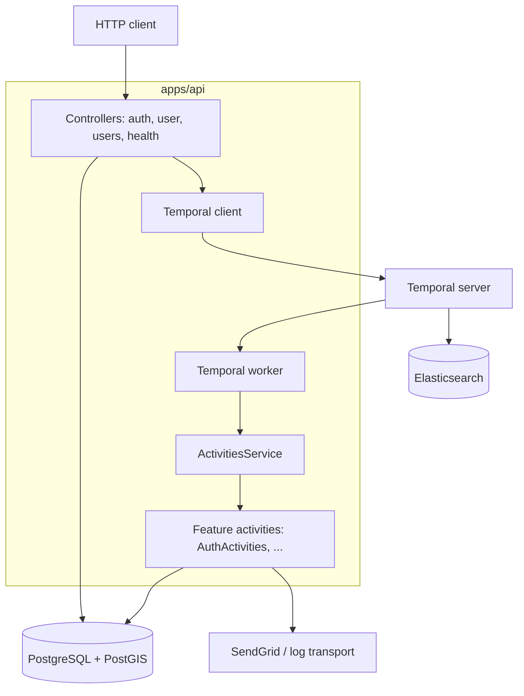
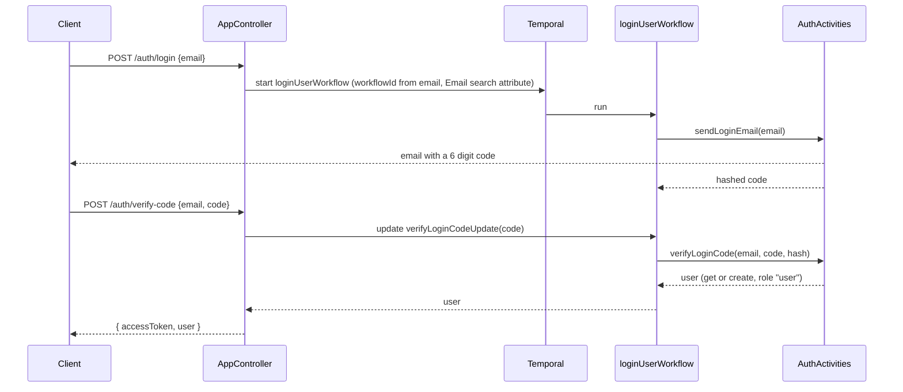
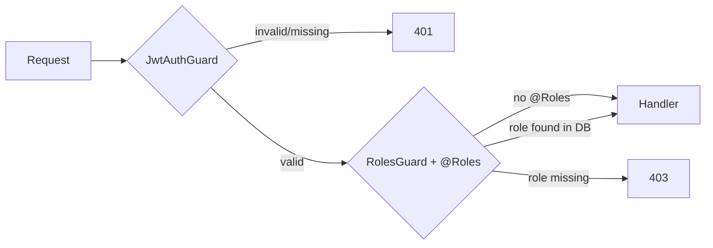

# Architecture Overview

ProjectX API is one NestJS application, `apps/api`, that serves HTTP and runs a Temporal worker in the same process. Shared code lives in workspace packages; the Temporal wrapper comes from npm.

## System

- **HTTP**: controllers validate DTOs from `@projectx/models` and call services; protected routes use `JwtAuthGuard` and, for roles, `RolesGuard`.
- **Temporal client and worker**: `WorkflowsModule.registerAsync` from `@proyecto26/temporal-workflows` provides `ClientService` and `WorkerService`. The worker polls `TEMPORAL_TASK_QUEUE` (default `api`), bundles `src/workflows`, and registers the methods of `ActivitiesService` as activities.
- **Database**: Prisma 7 with the PostgreSQL driver adapter, through repository services in `@projectx/db`.

`@proyecto26/temporal-workflows` is consumed from npm; it is developed and published from the [ProjectX repository](https://github.com/proyecto26/projectx) (`packages/workflows`).

## Authentication flow

The workflow waits for a valid code up to `LOGIN_WORKFLOW_TIMEOUT` and fails with `LoginCodeExpiredException` afterwards. The state can be read at any time with the `getLoginStateQuery` query. Outside development a SendGrid 401 fails the activity; in development with an empty `SENDGRID_API_KEY` the email (and the code) is written to the logs.

## Authorization

`RolesGuard` loads the user's roles with `UserRepositoryService.findRoles(userId)` on every request and stores them in `request.user.roles`. Roles are not put in the JWT, so revoking one takes effect on the next request. Roles: `admin` and `user` (seeded); `ADMIN_EMAILS` are promoted to `admin` by the seed.

Before that, `JwtStrategy.validate()` loads the token's account (`UserRepositoryService.findActiveById`) and rejects the token with `401` unless the account exists and is `Active`. Access tokens are stateless JWTs (12 days), so this lookup is what revokes them: suspending or deleting an account takes effect on its next request, with no denylist. This is the check the NestJS authentication docs suggest for `validate()`, and it matches what Better Auth does when banning a user (it deletes all of the user's sessions).

## Routes

Routes have no global prefix; set `API_PREFIX` (e.g. `v1`) to add one, `/health` stays excluded. Modules: `src/auth/` and `src/users/`.

| Route | Access | Description |
|-------|--------|-------------|
| `POST /auth/login` | public | Start the login workflow, email a code |
| `POST /auth/verify-code` | public | Verify the code, return a JWT |
| `GET /users/me`, `PATCH /users/me` | JWT | Read and update the current user |
| `GET /users` | JWT + `admin` | List users (example admin route) |
| `GET /health` | public | Database, memory and Temporal readiness |
| `/swagger` | public | Swagger UI |

## Activity registration

The worker registers activities from one object: the functions on the immediate prototype of `ActivitiesService` (`apps/api/src/activities/activities.service.ts`). To keep features separate while respecting that:

1. Each feature writes its activities in an injectable class, `<feature>.activities.ts`, provided and exported by its module (e.g. `AuthActivities` in `AuthActivitiesModule`).
2. `ActivitiesModule` imports those modules and provides `ActivitiesService`.
3. `ActivitiesService` injects each class and declares one method per activity that delegates to it.
4. Workflows type their proxies with `proxyActivities<ActivitiesService>()` through a type-only import.

`pnpm gen:workflow` generates all four steps and a test. `discoverActivities` (`apps/api/src/activities/discover-activities.ts`) reproduces the worker's discovery for tests.

## Health

`GET /health` (Terminus) checks the database, heap and RSS, and Temporal through `TemporalHealthIndicator` (`apps/api/src/temporal`): the client is connected, the namespace describes and, when the wrapper reports it, the worker is running. Docker Compose uses it as the API's healthcheck.

## Packages

| Package | Contents |
|---------|----------|
| `@projectx/core` | Bootstrap (`bootstrapApp`), CoreModule, JWT strategy and guard, `Roles`/`RolesGuard`, config validation, logger, health, Swagger, hashing, workflow definitions (`@projectx/core/workflows`) |
| `@projectx/db` | Prisma schema, migrations, seed, `PrismaService`, repository services |
| `@projectx/models` | DTOs, enums (`Environment`, `RoleName`, `UserStatus`), validators, transforms |
| `@projectx/email` | `EmailService`, MJML templates, SendGrid and log transports |
| `@projectx/cli` | `pnpm cli` (init, info, generate) |

## Technology stack

- **API**: NestJS 12, TypeScript (strict), Passport JWT, Terminus, Swagger, Pino
- **Workflows**: Temporal (server 1.32, TypeScript SDK 1.25) through `@proyecto26/temporal-workflows`
- **Database**: PostgreSQL 17 + PostGIS, Prisma 7
- **Email**: SendGrid, MJML
- **Tooling**: Turborepo, pnpm, Biome, Jest, Docker Compose
